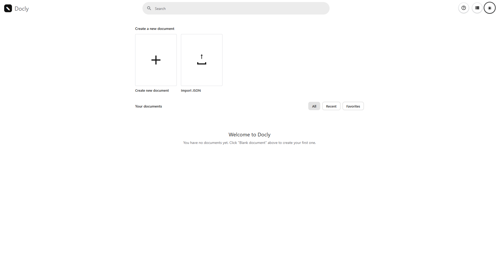
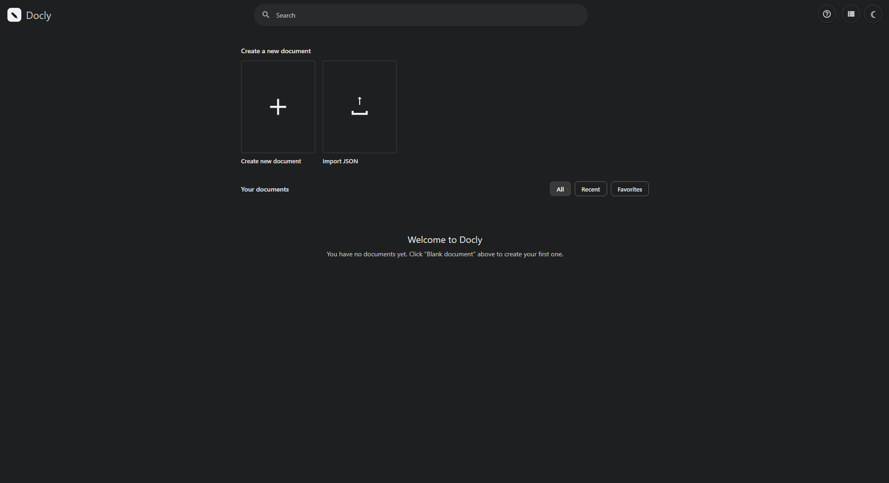
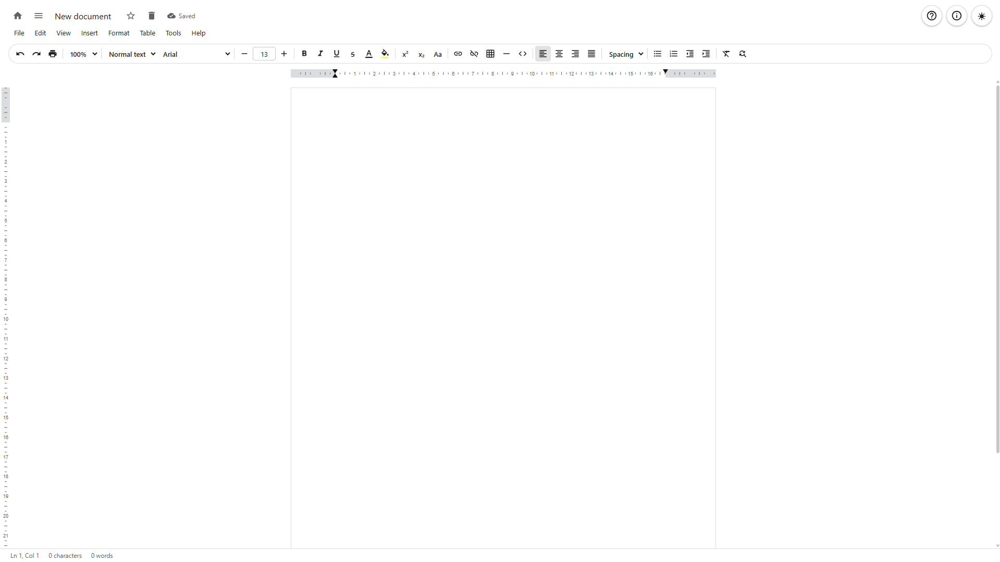
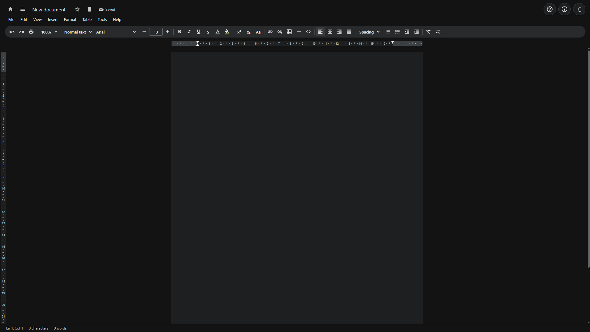

# Docly

**Docly** is a word processor that runs entirely on your computer: no account, no cloud, no Internet. Your documents are plain files in the `documents/` folder.









---

## How to use

### Start

1. Install **Python 3** (tick *Add Python to PATH*): <https://www.python.org/downloads/>
2. Unzip the `Docly` folder anywhere.
3. Double-click **`start.bat`**. The browser opens Docly at `http://127.0.0.1:8756`.

On macOS/Linux run `python3 server.py` inside the `Docly` folder.

To quit: wait for **Saved** at the top, close the tab, then close the black server window (or `Ctrl+C`).

### First steps

1. On the home page click **Create new document** (or **Import** a Word, Markdown, text, HTML, Docly JSON or ZIP file; you can also drop files on the home page).
2. Type a name, press **OK** and start writing in the page.
3. Everything saves automatically less than a second after each change.
4. Export from **File ▸ Download** (Word, OpenDocument, RTF, PDF, TXT, HTML, EPUB, Markdown, JSON backup). Organize documents in **folders** (drag and drop) and select several at once to move, export or delete them.

### Quick commands

| Keys | Action | Keys | Action |
|---|---|---|---|
| `Ctrl+S` | Save | `Ctrl+Z` / `Ctrl+Y` | Undo / Redo |
| `Ctrl+N` | New document | `Ctrl+C` `X` `V` | Copy / Cut / Paste |
| `Ctrl+O` | Open (search) | `Ctrl+Shift+V` | Paste without formatting |
| `Ctrl+B` / `I` / `U` | Bold / Italic / Underline | `Ctrl+A` | Select all |
| `Ctrl+K` | Insert or edit link | `Ctrl+F` | Find |
| `Ctrl+Alt+1…6` | Heading 1–6 | `Ctrl+H` | Find and replace |
| `Ctrl+Shift+7` / `8` / `9` | Numbered / bulleted / check list | `Ctrl+P` | Print |
| `Ctrl+Enter` | Page break | `Ctrl+/` or `F1` | All shortcuts |
| `Ctrl+Alt+F` | Footnote | | |

---

## Full list of commands

### Keyboard shortcuts

**Common actions**

| Keys | Action |
|---|---|
| `Ctrl+S` | Save |
| `Ctrl+N` | New document |
| `Ctrl+O` | Open document (search) |
| `Ctrl+P` | Print |
| `Ctrl+C` / `Ctrl+X` / `Ctrl+V` | Copy / Cut / Paste |
| `Ctrl+Shift+V` | Paste without formatting |
| `Ctrl+Z` | Undo |
| `Ctrl+Y` / `Ctrl+Shift+Z` | Redo |
| `Ctrl+K` | Insert or edit link |
| `Ctrl+F` | Find (opens the search bar) |
| `Ctrl+G` / `Ctrl+Shift+G` | Find next / previous |
| `Esc` | Close the search bar |
| `Ctrl+H` | Find and replace |
| `Ctrl+A` | Select all |
| `Ctrl+/` | Show keyboard shortcuts |
| `Ctrl+Shift+C` | Word count |
| `Ctrl+Shift+F` | Compact controls (hide toolbar) |

**Text formatting**

| Keys | Action |
|---|---|
| `Ctrl+B` / `Ctrl+I` / `Ctrl+U` | Bold / Italic / Underline |
| `Alt+Shift+5` | Strikethrough |
| `Alt+Shift+K` | Small caps |
| `Ctrl+.` / `Ctrl+,` | Superscript / Subscript |
| `Ctrl+Shift+.` / `Ctrl+Shift+,` | Increase / decrease font size |
| `Ctrl+\` | Clear formatting |
| `Ctrl+Alt+C` / `Ctrl+Alt+V` | Copy / paste text formatting |
| `Shift+F3` | Cycle capitalization |

**Paragraph formatting**

| Keys | Action |
|---|---|
| `Ctrl+Alt+0` | Normal text |
| `Ctrl+Alt+1` … `6` | Heading 1 – 6 |
| `Ctrl+Shift+L` / `E` / `R` / `J` | Align left / center / right / justify |
| `Ctrl+Shift+7` | Numbered list |
| `Ctrl+Shift+8` | Bulleted list |
| `Ctrl+Shift+9` | Checklist |
| `Ctrl+]` / `Ctrl+[` | Increase / decrease indent |
| `Ctrl+1` / `Ctrl+5` / `Ctrl+2` | Single / 1.5 / double line spacing |
| `Ctrl+0` | Add / remove space before paragraph |

**Insert and tables**

| Keys | Action |
|---|---|
| `Ctrl+Enter` | Page break |
| `Ctrl+Alt+F` | Insert a footnote |
| `Tab` / `Shift+Tab` | Next / previous table cell (a new row is added after the last cell) |

**Menus**

| Keys | Action |
|---|---|
| `Alt+Shift+F` | File |
| `Alt+Shift+E` | Edit |
| `Alt+Shift+V` | View |
| `Alt+Shift+I` | Insert |
| `Alt+Shift+O` | Format |
| `Alt+Shift+B` | Table |
| `Alt+Shift+T` | Tools |
| `Alt+Shift+H` | Help |

**Navigation**

| Keys | Action |
|---|---|
| `Ctrl+Home` / `Ctrl+End` | Start / end of the document |
| `Ctrl+←` / `Ctrl+→` | Move by word |
| `Ctrl+Shift+←` / `Ctrl+Shift+→` | Select by word |
| `Shift+Home` / `Shift+End` | Select to start / end of line |

While you type in a text field (search, dialogs) the editor shortcuts are disabled; only `Ctrl+S`, `Ctrl+N`, `Ctrl+O`, `Ctrl+P`, `Ctrl+/` and `F1` stay active. Browsers may reserve some combinations: use the menus instead.

### Mouse

| Action | What it does |
|---|---|
| Click a document in the list | Open it |
| Click the title (top bar) | Rename the document |
| Click the ☆ star | Add / remove from Favorites |
| Click the 🗑 bin | Delete (see *Delete* below) |
| Drag a document onto a folder (home) | Put it inside (if it is selected, the whole selection moves) |
| Drag a document onto **Take out of folder** (appears while dragging) | Remove it from its folder |
| Click the circle on a document (home) | Select it; `Ctrl`/`Shift`+click also selects; `Esc` clears the selection |
| Drop files on the home page | Import them |
| Click a footnote number | Jump to the note (and back from the note) |
| Double-click a form field box | Rename it / change the options of a dropdown list |
| Click a link | Open it in a new tab |
| Drag across table cells | Select cells |
| Right-click inside a table | Table menu |
| Click on the minimap | Jump to that part of the document |

### Interface buttons

- **Top bar**: home, document list, document name (click to rename), favorite, delete, save status (*Saving…* / *Saved*), menus.
- **Toolbar**: Undo, Redo, Print, Zoom, Paragraph style, Font, Font size − / +, Bold, Italic, Underline, Strikethrough, Text color, Highlight, Superscript, Subscript, Change case, Link, Remove link, Table, Horizontal line, Code block, Align (left, center, right, justify), Line spacing, Bulleted list, Numbered list, Decrease / increase indent, Clear formatting, Find and replace.
- **Top right**: Help, Program info, Light / dark theme.
- **Home**: search, Create new document, Import, list / grid view, filters **All / Recent / Favorites**, folder tiles (**All documents**, your folders, **New folder**), a 📁 button on every document, and a selection bar (Select all, Move to folder, Take out of folder, Export ZIP, Delete) when documents are selected.
- **Status bar**: cursor position (line, column), characters, words, current page.

### Menus

- **File**: New document · Open document · All documents (home) · Make a copy · Download ▸ (Word, OpenDocument, RTF, PDF, TXT, HTML, EPUB, Markdown, Docly backup JSON) · Import… · Save · Rename · Add / remove favorite · Tags… · Move to folder… · Move to trash · Language ▸ · Page setup · Print · Document details · Word count · Show file path
- **Edit**: Undo · Redo · Cut · Copy · Paste · Paste without formatting · Select all · Delete · Find · Find and replace · Copy formatting · Paste formatting · Clear formatting · Editing preferences ▸ Spelling check
- **View**: Mode ▸ (Editing, Viewing) · Print layout (pages) · Ruler · Document outline · Non-printing characters · Toolbar · Minimap · Document list · Zoom ▸ (50% – 200%) · Full screen · Light / dark theme
- **Insert**: Table · Emoji and special characters · Link · Horizontal line · Code block · Checklist · Page break · Footnote · Header & footer… · Page numbers ▸ · Date and time ▸ · Form field ▸ (Text field, Text area, Checkbox, Dropdown list) · Bookmark · Link to heading or bookmark · Table of contents ▸ (insert, update)
- **Format**: Text ▸ · Font ▸ · Font size ▸ · Capitalization ▸ · Page orientation ▸ · Paragraph styles ▸ (Normal, Title, Subtitle, Heading 1–6, Quote) · Align ▸ · Lists ▸ · Indent ▸ · Line spacing ▸ · Paragraph spacing ▸ · Paragraph borders and shading ▸ · Clear formatting
- **Table**: Insert table · Insert row above / below · Insert column left / right · Delete row / column / table · Merge cells · Split cell · Distribute rows / columns · Cell vertical and content alignment · Cell background color · Border color and width · Column width · Minimum row height · Header row · Table properties
- **Tools**: Word count · Spelling check · Change case · Text color · Highlight color
- **Help**: Program info · License · Keyboard shortcuts

### Context menu (right-click)

- **Inside a table**: the **Table** menu (rows, columns, merge, split, alignment, colors, borders, properties).

---

## Full list of functions

### Documents

- **Create**: **Create new document** on the home page, `Ctrl+N` or File ▸ New document. Imported and copied documents are new documents too.
- **Rename**: click the title, or File ▸ Rename. The folder on disk is renamed with it.
- **Favorites and tags**: star a document to find it under **Favorites**; add comma-separated tags with File ▸ Tags… Search covers title, text and tags.
- **Recent**: the 15 most recently modified documents.
- **Make a copy**: File ▸ Make a copy creates *Copy of …* with the same content.
- **Document details**: title, creation and modification dates, words, characters, tables, tags. **Show file path** gives the folder on disk.
- **Delete**: two confirmations. First *Cancel / Delete*, then *Cancel / Delete / Export JSON and delete*. The folder goes to the **Recycle Bin / Trash**.
- **Restore**: export with *Export JSON and delete* (or File ▸ Download ▸ Docly backup), then **Import** it (or the backup ZIP) on the home page: the document comes back with its title, content, tags, favorite and dates, as if it had never been deleted.
- **Folders**: the folder tiles on the home page work like real folders.
  - **Put documents in**: drag a document (or the whole selection) onto a folder tile; or click the 📁 button on the document (also in the document list) and choose a folder; or File ▸ Move to folder…. Dropping on **New folder** creates a folder and puts the document in it.
  - **Take documents out**: drag them onto **Take out of folder** (it appears while you drag), or click the 📂 button and choose *Take out of folder*, or use **Take out of folder** in the selection bar.
  - **Open a folder**: click its tile (click **All documents** to see everything again). The open folder can be renamed or deleted (its documents are kept and simply leave the folder).
  - **Empty folders stay**: the list of folders is saved in `documents/preference.json`, and each document stores its folder name in `document.json`, so the document folders on disk do not change.
- **Multiple selection**: click the circle on a document (or `Ctrl`/`Shift`+click) on the home page, then **Move to folder**, **Take out of folder**, **Export (ZIP)** (one `<Name>_Docly.json` per document) or **Delete** (same two confirmations, with *Export ZIP and delete*).
- **Names**: up to 120 characters, spaces allowed, invalid Windows characters removed, duplicates get `(2)`, `(3)`…; folders are named `NAME_Docly`.

### Text and paragraphs

- **Character formatting**: bold, italic, underline, strikethrough, small caps, superscript, subscript, font, size, text color, highlight, change case (lowercase, UPPERCASE, Title Case).
- **Paragraph styles**: Normal text, Title, Subtitle, Heading 1–6, Quote.
- **Paragraphs**: alignment, indents, line spacing (single, 1.15, 1.5, double), space before / after, borders and shading.
- **Lists**: bulleted, numbered and checklists; typing a list marker starts a list automatically.
- **Copy / paste formatting** and **clear formatting**.
- **Paste**: text copied from other programs (Word, web pages…) takes the document's font instead of bringing its own (for example Comic Sans), and images are removed (see *Limits*); content copied inside Docly keeps its fonts; `Ctrl+Shift+V` pastes plain text.
- **Speed**: with the whole document selected (`Ctrl+A`), changing the font is instant even on long documents.

### Insert

- **Tables**: size picker, rows, columns, merge and split cells, cell selection, header row, column width, row height, borders, background colors, alignment, distribute evenly.
- **Links**: to a web page (opens in a new tab), to a heading or to a bookmark; pasting a URL over selected text makes a link.
- **Bookmarks and table of contents**: insert, update.
- **Header, footer and page numbers**: Insert ▸ Header & footer… (text for the header and the footer, page numbers in any of the six corners, optionally hidden on the first page). In the text, `{page}`, `{pages}`, `{title}` and `{date}` are replaced automatically. They appear on printed pages, in the PDF and in Word (as real page fields); the editor shows a preview at the top and bottom of the page.
- **Form fields**: Insert ▸ Form field ▸ **Text field**, **Text area**, **Checkbox** or **Dropdown list**. In the editor a field is a dashed box with a label (a reminder, not writable); it is saved as a normal element of the document, so nothing changes in how documents are stored. Double-click a box to rename it or change the options of a dropdown list. In the exported **PDF** every box becomes a real, clickable form field (see *Save and export*).
- **Footnotes**: `Ctrl+Alt+F` inserts a numbered reference and a note you type right away. Notes are listed at the end of the document, renumbered automatically when you add, move or delete references.
- **Other**: horizontal line, code block, emoji and special characters, date and time, page break.

### Find and replace

`Ctrl+F` opens a search bar at the top right of the page (like Google Docs): type and every match is highlighted in **yellow**, the current one in **orange**, with a counter such as *1 of 12*. **Enter** / **Shift+Enter** (or the up / down arrows, or `Ctrl+G` / `Ctrl+Shift+G`) move between matches, **Esc** closes the bar. The search ignores upper / lower case, finds words split by bold or italic, and updates while you edit. If text is selected when you press `Ctrl+F` it is used as the search term. Highlights are only drawn on screen: they are never saved or exported. `Ctrl+H` finds and replaces.

### View

- **Print layout** (pages): the document is shown as separate sheets with a gap between them, like Google Docs. Text that does not fit at the bottom of a sheet continues on the next one, headings are kept with the text that follows, single lines are not left alone, and header, footer and page numbers appear on every sheet. A **Page X of Y** indicator is in the status bar. Or continuous page, ruler showing page, margins and indent markers, **document outline** (headings), **minimap** (off by default), non-printing characters, zoom 50–200%, full screen, hide the toolbar, document list on the left.
- **Modes**: *Editing* or *Viewing* (read only).
- **Theme**: light or dark. Theme, language, ruler, minimap, toolbar, margins, page setup and recent colors are saved in `documents/preference.json`, next to your documents (see *Settings* below).

### Page setup

Paper **Letter**, **A4** or **Legal**, portrait or landscape, margins in centimeters (top, bottom, left, right), page color.

### Language and spelling

Document language (English, Italiano, Español, Français, Deutsch, Português) and browser spell check on / off.

### Preferences file

Everything Docly remembers besides the documents themselves is in **one JSON file: `documents/preference.json`**. It holds the list of **folders** (including empty ones) and your **settings** (theme, language, spell check, ruler, minimap, toolbar, margins, page setup, recent colors):

```json
{
  "folders": ["Ideas", "Work"],
  "settings": { "docly-theme-v2": "dark", "docly-lang": "en" }
}
```

It is updated a moment after each change and read when Docly starts. Each document also keeps its own folder name inside its `document.json`. If you move or copy the `documents` folder, or open Docly with another browser, documents, folders and settings are all still there. Files from older versions (`.folders.json`, `.settings.json`) are merged into `preference.json` automatically and then removed.

### Save and export

- **Save**: autosave less than a second after each change, manual `Ctrl+S`, status *Saving… / Saved*, safe atomic writes, warning if you close the tab with unsaved changes.
- **Download**: Word `.docx`, OpenDocument `.odt`, Rich Text `.rtf`, `.pdf`, plain text `.txt`, web page `.html`, `.epub`, Markdown `.md`, and **Docly backup** `.json`.
- **PDF**: generated directly in the browser (no print dialog, no browser header or footer). Text stays selectable, links are **blue** and clickable, and header, footer and page numbers are drawn on every page. **Fonts are embedded**: in Chrome or Edge the first export asks permission to read the installed fonts, then Arial, Georgia, Times New Roman, Courier New… are stored in the PDF (TrueType fonts; a missing bold or italic is simulated). Without permission, or in other browsers, the standard PDF fonts are used. **Fillable forms**: every form field of the document becomes a real PDF form field (AcroForm) placed on the same line of text as in the editor (box with border and white background; text field, multi-line text area, checkbox, dropdown list, each with its name and options). Opened in Chrome, Edge, Adobe Reader or Foxit the boxes are clickable: whoever receives the PDF can type, tick or choose from the list, save with `Ctrl+S` and send it back with the answers included. Fields with the same name get `_2`, `_3`… so every box is independent. The PDF is positioned by Docly's own page layout, so a box is where the text flow puts it, which can differ by a few points from the screen.
- **Docly backup**: file named `<Document name>_Docly.json` with the whole document (title, content, tags, favorite, page setup, dates).
- **Import**: Word `.docx`, Markdown `.md`, text `.txt`, web page `.html`, the Docly backup `.json`, and a `.zip` containing any of them (for instance a backup ZIP). Several files can be imported at once. It always creates new documents and never overwrites an existing one.
  - **Word**: paragraphs, headings, bold, italic, underline, strikethrough, colors, highlight, sizes, links, bulleted and numbered lists, tables (with merged cells) and page breaks. Images, headers, footers and footnotes of the Word file are not imported.
  - **Markdown**: headings, bold, italic, code, links, lists (also nested and checklists), quotes, tables, code blocks and horizontal lines.
  - **HTML**: structure and basic formatting; scripts, images, classes and fonts are dropped.
- **Print**: `Ctrl+P` prints the page without the interface.

---

## About the project

### Folder structure

```
Docly/
├── start.bat      ← double-click to start
├── server.py      ← local server and API (Python standard library only)
├── README.md
├── images/        ← 4 screenshots (home and editor, light and dark)
├── static/        ← index.html, style.css, app.js, preference.js (the editor)
└── documents/     ← your documents: one folder each, named NAME_Docly, with document.json (plus preference.json)
```

### How it works

- **Backend**: `server.py` serves the site and saves documents to disk through a small REST API. It listens only on `127.0.0.1:8756`.
- **Frontend**: plain HTML, CSS and JavaScript with no framework or external libraries. All exports (Word, OpenDocument, RTF, PDF, EPUB and the others) are generated in the browser.
- **Privacy**: nothing leaves your computer and it works fully offline. Folders and preferences are saved in `documents/preference.json`.
- **Data**: `document.json` holds id, title, content (HTML), tags, favorite, folder, header / footer settings and dates. Backup = copy the `documents/` folder (documents, folders and settings), or use Docly backup (JSON) → Import JSON.

| Method | Path | Function |
|---|---|---|
| `GET` / `POST` | `/api/documents` | list / create |
| `GET` / `PUT` / `DELETE` | `/api/documents/<id>` | read / save / move to Recycle Bin |
| `GET` | `/api/documents/<id>/path` | folder path on disk |
| `PUT` | `/api/documents/<id>/rename` · `/favorite` | rename / toggle favorite |
| `PUT` | `/api/collections/create` · `/rename` · `/delete` | create / rename / remove a folder |
| `GET` | `/api/search?q=` | search title, text and tags |

### Limits and tips

- **Images are not supported**: pictures are removed when you paste, drop or import content that contains them. Docly is for text, tables and lists.
- Page size, orientation, color and margins apply to every document, not to a single one.
- The `.docx`, `.odt`, `.rtf` and `.epub` exports have not been checked in every program; open them once before sending them.
- PDF font embedding needs Chrome or Edge and the *local fonts* permission, and works with TrueType fonts (`.ttf`); OpenType/CFF (`.otf`) and font collections (`.ttc`) fall back to the standard PDF fonts.
- Footnotes are listed at the end of the document, not at the bottom of each page. A table taller than one sheet is not split between sheets (a table that fits is moved whole to the next sheet). Headers, footers and page numbers are exported to print, PDF and Word (not to the other formats).
- Form fields are fillable only in the PDF export. Word, OpenDocument, RTF, Markdown and EPUB show a plain mark (`[ ........ ]`, `[ ]`, `[ v ]`); the web page export uses real HTML controls. Docly stays a word processor: it creates the fields, it does not edit existing PDFs.
- A folder holds documents of one level only (no folders inside folders).
- The instant font change applies to the whole document (`Ctrl+A`); a partial selection uses the browser's normal command.
- Old version still showing? Reload with `Ctrl+F5`. Port 8756 busy? Docly is already running: close the other window.

---

*Docly: local word processor. All data stays on your computer.*
